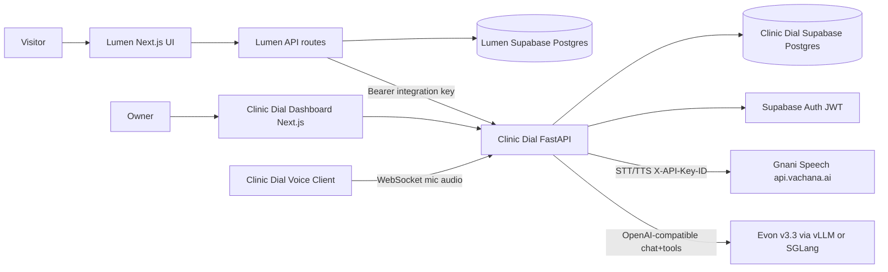

# Clinic Dial — Product Requirements Document (POC)

## 1. Product summary

**Clinic Dial** is a multi-clinic AI receptionist and clinic operations platform. Independent clinic owners create an account, connect their existing website, receive consultations and appointment requests, manage customers/services/bookings, and monitor an AI receptionist.

- **Clinic Dial** (`./lala/`): the product — greenfield SaaS.
- **Lumen** (`./lumen-website/`): an independent example clinic website used as the first integration client. Not the product.
- **Gnani**: speech and LLM vendor for Milestone C (Speech APIs for STT/TTS, and the Evon v3.3 open-weight LLM). Not a product name. Sources: [console](https://app.gnani.ai/), [docs](https://docs.gnani.ai/), [quick start](https://docs.gnani.ai/api/introduction/quick-start), [Evon model card](https://huggingface.co/gnani/gnani-evon-v3.3-30B-A3B).

Clinic Dial must not depend on Lumen or any particular clinic. Both apps stay independently runnable and deployable.

## 2. Problem statement

Small clinics get enquiries from their own websites but lack a shared, multi-tenant operations layer for customers, appointments, and AI receptionist handoff. Building per-clinic tooling duplicates work and leaks data across clinics when isolation is weak. Clinic Dial provides one operations dashboard with per-clinic isolation and a secure website integration API.

## 3. Target users

| Role | POC build? | Summary |
|---|---|---|
| Clinic Owner | Yes | Manages clinic, integrations, customers, appointments, AI settings |
| Customer | Yes (via Lumen) | Submits consultations; later books via AI receptionist |
| AI Receptionist | Yes (Milestone C) | Narrowly authorised CRM actions via backend APIs only |
| Platform Administrator | Documented only | Platform config and integration health; no unrestricted customer data |
| Clinic Administrator | Documented only | Day-to-day ops with owner-granted permissions |
| Clinic Staff | Documented only | Permitted appointments, enquiries, handover |

## 4. Product goals

1. Multi-tenant clinic CRM with strict isolation.
2. Secure server-to-server website integration (Lumen first).
3. Real enquiry → customer → appointment flow backed by the database.
4. Browser voice AI receptionist (Gnani STT/TTS + self-hosted Evon v3.3) as a separable milestone.
5. Demo-ready POC with no fabricated metrics or fake conversations.

## 5. POC success criteria

1. Visitor submits a Lumen consultation; Lumen stores it; Lumen server forwards to Clinic Dial.
2. Clinic Dial authenticates the integration key, resolves the clinic, upserts customer, stores enquiry.
3. Clinic owner sees the enquiry in the Clinic Dial dashboard from live data.
4. Owner creates an appointment against real availability; conflicts are rejected.
5. A second test clinic cannot see the first clinic’s data.
6. Milestones A+B work without voice. Voice (C) is optional for the website→dashboard demo.

## 6. User roles and permissions

### 6.1 Platform Administrator (planned)

- Manage platform config and integration health dashboards.
- No default unrestricted access to clinic customer PII.
- Cannot impersonate clinic owners without an audited break-glass process (out of POC).

### 6.2 Clinic Owner (POC)

- Full CRUD on own clinic settings, services, availability, customers, appointments.
- Generate/rotate website integration API keys (plaintext shown once).
- View activity history and (Milestone C) conversations/recordings with consent.
- Invite clinic admins/staff — **out of POC** (document only).

### 6.3 Clinic Administrator (planned)

- Day-to-day operations within permissions granted by the owner.
- No key rotation or clinic deletion unless granted.

### 6.4 Clinic Staff (planned)

- Handle permitted appointments, enquiries, and handover tasks.
- No integration credentials or billing.

### 6.5 AI Receptionist (POC Milestone C)

- Browser voice → Clinic Dial FastAPI WebSocket; Gnani STT/TTS via `gnani-vachana`; reasoning via self-hosted Evon v3.3.
- Acts only through Clinic Dial backend tool APIs with a clinic-scoped, least-privilege service identity; every model tool call is validated before side effects.
- May list services, check availability, create/reschedule appointments with verification, escalate to staff. No cross-clinic reads; no deletes.
- Must never diagnose or recommend medical treatment; disclose that it is AI; escalate when unsure.
- Recording/transcript only with explicit consent.

### 6.6 Customer (POC via Lumen; later voice)

- Submit consultation with name, email, optional phone, service choice, consent.
- Receive permitted appointment communications (planned; minimal in POC).

## 7. End-to-end user journeys

### 7.1 Website enquiry → Clinic Dial CRM (Milestone A)

1. Visitor opens Lumen → selects category + treatment → enters details + consent.
2. Browser POSTs to Lumen `/api/consultations` (not to Clinic Dial).
3. Lumen saves enquiry in its own Supabase, then server-forwards to Clinic Dial.
4. Clinic Dial authenticates key → resolves clinic → dedupes customer by email → stores enquiry.
5. Owner logs into Clinic Dial dashboard → sees enquiry / customer.

### 7.2 Appointment management (Milestone B)

1. Owner opens customer → creates appointment from availability.
2. Backend rejects conflicts and unauthorised clinic access.
3. Dashboard reflects DB state; activity history records the action.

### 7.3 AI receptionist (Milestone C)

1. Customer uses browser voice client; mic audio streams to Clinic Dial FastAPI over WebSocket (browser never holds Gnani or LLM secrets).
2. Backend turn: Gnani STT (realtime) → Evon v3.3 (OpenAI-compatible chat + tools) → backend validates every tool call → Gnani TTS (SSE or realtime) → audio to browser.
3. Tools (clinic-scoped, least privilege): list services, check availability, create/reschedule appointment (with verification), escalate to staff. No cross-clinic reads; no deletes.
4. System rules: answer in caller language/script; disclose AI; never diagnose or recommend treatment; escalate when unsure.
5. Session/transcript/(consented) recording stored in Clinic Dial, tied to clinic + customer.

### 7.4 Multi-clinic isolation demo (Milestone D)

1. Two clinics with separate owners and integration keys.
2. Enquiry for clinic A never appears for clinic B.
3. RLS + backend clinic checks both enforced.

## 8. Functional requirements

| ID | Requirement | Milestone | Status |
|---|---|---|---|
| F1 | Clinic signup/login (Supabase Auth) | A | Done (dashboard + JWT verify; durable clinic rows need Clinic Dial Supabase migrations applied) |
| F2 | Per-clinic tenant isolation (RLS + backend) | A | Done (RLS migrations + API membership checks / isolation tests) |
| F3 | Website integration API key (hashed at rest) | A | Done |
| F4 | Ingest consultation + customer dedupe | A | Done |
| F5 | Dashboard: overview, enquiries, customers, integrations, activity | A | Done |
| F6 | Lumen server-side forward + `forward_status` | A | Done (Lumen forward module) |
| F7 | Services + availability management | B | Done (`/v1/services`, `/v1/availability`, dashboard) |
| F8 | Appointments + conflict prevention | B | Done (`/v1/appointments`, conflict tests) |
| F9 | Minimal clinic settings (timezone default `Asia/Kolkata`) | B | Done (clinic timezone on create + appointment display) |
| F10 | Browser voice client + Gnani STT/TTS via `gnani-vachana` SDK | C | Partial (mock path done; live needs Gnani key) |
| F10b | Evon v3.3 self-hosted LLM (vLLM/SGLang) as receptionist brain | C | Blocked (needs HF access + GPU host — owner decision) |
| F11 | Receptionist CRM tools + escalation (backend-validated) | C | Done (mock tools + escalate) |
| F12 | Conversations, transcripts, handover inbox | C | Done (Epic 7) |
| F13 | Minimal analytics from real counts | D | Done (`GET /v1/analytics`, dashboard Analytics module) |

### Deduplication (Clinic Dial schema)

- Customer unique per clinic by normalised email (trim + lower-case).
- On email match: fill missing fields (e.g. phone); do not overwrite existing values without an activity history entry.
- Phone normalised to E.164 is a secondary signal only — flag possible duplicates; never auto-merge.
- Every enquiry is its own row linked to the customer.

### Failure and retry (Lumen → Clinic Dial)

Fits existing Lumen code (local save in `saveEnquiry`, then respond):

1. Save locally first.
2. Forward server-side up to **twice** with short backoff.
3. Persist `forward_status`: `forwarded` | `rejected` | `pending`.
4. 4xx → `rejected`, no retry, log reason.
5. 5xx / timeout / network → retry once, else `pending`.
6. Visitor success once local save succeeds, regardless of forward status.

## 9. Non-functional requirements

| Area | Requirement |
|---|---|
| Performance | Integration ingest p95 < 2s excluding Lumen local save |
| Availability | Lumen remains usable if Clinic Dial is down (`pending` forward) |
| Security | No secrets in browser / `NEXT_PUBLIC_*`; hashed integration keys |
| Privacy | Consent value + timestamp + text/version; DPDP-aware retention |
| Time | Store appointment/availability UTC; display in clinic timezone |
| Quality | Backend tests for auth, isolation, booking conflicts |
| Migrations | Additive only |

## 10. System architecture

### `./lala/` layout (Epic 1 scaffold present)

```text
lala/
  apps/
    dashboard/          # Next.js owner workspace
    voice-client/       # Visitor receptionist (browser)
  backend/              # FastAPI
    app/
      api/              # me, clinics, integrations, crm, bookings, voice
      core/             # settings, security
      models/           # Pydantic schemas
      services/         # domain + clinic store (in-memory or Postgres)
      tests/
  supabase/
    migrations/         # additive SQL + RLS
  docs/                 # PRD, STATUS, DEMO_RUNBOOK, DECISIONS, …
```

### Mermaid — runtime (POC)



Lumen and Clinic Dial use **separate** Supabase projects. Clinic Dial never points at Lumen’s `SUPABASE_DB_URL`.

### Milestone C — Gnani Speech + Evon (verified against public docs)

| Item | Fact | Source |
|---|---|---|
| Speech base host | `api.vachana.ai`; auth header `X-API-Key-ID` | [Quick start](https://docs.gnani.ai/api/introduction/quick-start) |
| STT REST | `POST https://api.vachana.ai/stt/v3`, multipart `audio_file`, ≤30s; Prisma v2.5 default; `prisma-v3.0` + `indic-auto` | Same |
| STT realtime | `wss://api.vachana.ai/stt/v3/stream`; 16-bit mono PCM 8/16 kHz; 1024-byte frames | Same |
| STT languages | Include `en-IN`, `hi-IN`, `te-IN` | [STT languages](https://docs.gnani.ai/api/STT/languages) |
| TTS | REST `/api/v1/tts/inference`; SSE `/api/v1/tts/sse`; WS `wss://api.vachana.ai/api/v1/tts`; recommended model `timbre-v2.5` | Quick start + TTS docs |
| Telugu voices (examples) | Suhana, Lehara, Lavanya, Yukti, Varuni | [Available voices](https://docs.gnani.ai/api/TTS/available-voices) |
| Python SDK | Package `gnani-vachana` (import `gnani`); clients `GnaniSTTClient`, `GnaniSTTStreamClient`, `GnaniTTSClient`, `GnaniTTSStreamClient`, `GnaniTTSRealtimeClient` — **use in FastAPI, not hand-rolled HTTP** | [Python SDK](https://docs.gnani.ai/python-sdk/introduction) |
| Hosted Evon chat API | **Not listed** in Speech API docs (`llms.txt` / Speech section). Plan Evon as **self-hosted** only. | [docs index](https://docs.gnani.ai/llms.txt) |
| Evon model | Open-weight MoE ~30B total / ~3.5B active; BF16; 128K context; EN/HI/TE (+ other Indic); OpenAI-compatible messages + tool calls; serve with vLLM ≥0.12 or SGLang; hardware H100 80GB / H200 / A100 on Linux — **not a laptop** | [HF model page](https://huggingface.co/gnani/gnani-evon-v3.3-30B-A3B) |
| Model ID mismatch | Page URL repo: `gnani/gnani-evon-v3.3-30B-A3B`. Code snippets / citation often use `gnani/gnani-evon-v3.3`. **Decision: use the exact repository ID shown on the page you accept.** | Same |
| Tool use / medical | Tool use still improving on model card; not for medical advice. Clinic Dial must validate every tool call and enforce no-diagnosis itself. | Same |
| Out of scope | Gnani Agent Builder and phone-calling products | Prompt + docs |

**Proposed Clinic Dial server-only env names (never `NEXT_PUBLIC_*`):**  
`GNANI_API_KEY`, `GNANI_API_BASE_URL` (default `https://api.vachana.ai`), `GNANI_STT_MODEL` (e.g. `prisma-v3.0`), `GNANI_TTS_MODEL` (e.g. `timbre-v2.5`), `GNANI_TTS_VOICE_EN`, `GNANI_TTS_VOICE_HI`, `GNANI_TTS_VOICE_TE`, `LLM_BASE_URL`, `LLM_MODEL`, `LLM_API_KEY` (if protected).  
`HF_TOKEN` only on the GPU host that downloads the model — never in the Clinic Dial app.

**Language support status:** Hindi and Telugu are **documented** for both STT and TTS — **not yet tested in Clinic Dial**.

**Blockers (owner = you):** (1) Gnani API key from console, (2) Hugging Face access approval for Evon, (3) GPU hosting cost/choice for Evon.

## 11. Data ownership and synchronisation

| System | Owns | Sync |
|---|---|---|
| Lumen DB | Local enquiry copy, services catalog for the demo site, rate limits | Source for visitor UX; forwards to Clinic Dial after save |
| Clinic Dial DB | Authoritative CRM: clinics, customers, enquiries, appointments, availability, integrations, activity | Authoritative for appointments |
| Gnani Speech APIs | Ephemeral STT/TTS | No long-term PII store in Gnani for POC design; Clinic Dial stores consented transcripts |
| Evon v3.3 (self-hosted) | Turn-taking / tool-calling brain | Served on GPU via vLLM/SGLang; Clinic Dial calls OpenAI-compatible `/v1/chat/completions`; no hosted Evon API found in Speech docs |

### Proposed Clinic Dial tables (key columns)

| Table | Key columns |
|---|---|
| `clinics` | `id`, `name`, `timezone` (default `Asia/Kolkata`), `created_at` |
| `clinic_members` | `clinic_id`, `user_id`, `role` (`owner` for POC) |
| `website_integrations` | `id`, `clinic_id`, `key_hash`, `key_prefix`, `revoked_at`, `created_at` |
| `customers` | `id`, `clinic_id`, `email_normalized`, `full_name`, `phone_e164`, `created_at`; unique `(clinic_id, email_normalized)` |
| `consultations` | `id`, `clinic_id`, `customer_id`, `category`, `service_external_id`, `consent_*`, `source`, `idempotency_key`, `created_at`; unique `(clinic_id, idempotency_key)` |
| `services` | `id`, `clinic_id`, `name`, `category`, `price_paise`, `active` |
| `availability_slots` / rules | `clinic_id`, UTC window fields, service linkage as needed |
| `appointments` | `id`, `clinic_id`, `customer_id`, `service_id`, `starts_at_utc`, `ends_at_utc`, `status` |
| `activity_events` | `clinic_id`, `actor_type`, `action`, `entity_type`, `entity_id`, `payload` (no secrets) |
| `integration_activity` | `clinic_id`, `integration_id`, `status`, `reason`, `idempotency_key`, `created_at` |
| `conversations` / `transcripts` / `handovers` | Milestone C; consent-gated |

## 12. API integration requirements

### Endpoint

`POST /v1/integrations/website/consultations`

### Headers

```http
Authorization: Bearer <clinic_integration_api_key>
Content-Type: application/json
Idempotency-Key: <lumen_enquiry_id>
```

Clinic is resolved **only** from the key. Client-supplied clinic/tenant IDs are ignored/rejected.

### Request JSON

```json
{
  "external_enquiry_id": "xxxxxxxx-xxxx-xxxx-xxxx-xxxxxxxxxxxx",
  "full_name": "DEMO-Asha Rao",
  "email": "demo-asha@example.com",
  "phone": "+919876543210",
  "category": "Heal Your Mind",
  "service": {
    "external_id": "b1000000-0000-4000-8000-000000000001",
    "name": "Aroma Swedish Massage"
  },
  "consent": {
    "ai_call_consent": true,
    "consent_text": "I agree to receive calls from Lumen's AI receptionist about my enquiry.",
    "consent_version": "lumen-ai-calls-v1",
    "consented_at": "2026-11-10T10:30:00Z"
  },
  "source": {
    "website": "lumen",
    "submitted_at": "2026-11-10T10:30:00Z"
  }
}
```

Unknown fields → `400`. Strict schema validation.

### Responses

| Status | Meaning |
|---|---|
| `201` | Created |
| `200` | Duplicate idempotency key — original result returned |
| `400` | Validation error |
| `401` / `403` | Auth failure |
| `5xx` | Server error |

### Example `201` body

```json
{
  "consultation_id": "…",
  "customer_id": "…",
  "status": "accepted",
  "dedupe": { "customer": "created" }
}
```

### P1 (documented, not required for A)

HMAC request signing with timestamp to limit replay.

## 13. Security and privacy requirements

- Secure clinic login via Supabase Auth; JWT verified in FastAPI.
- Per-clinic RLS + backend clinic membership checks.
- Integration keys hashed (e.g. SHA-256 with server pepper); plaintext shown once.
- Server-side secrets only; never in browser or `NEXT_PUBLIC_*`.
- No exposed Supabase service-role keys to clients.
- Consent: value, timestamp, text/version.
- Recordings/transcripts: owning clinic only; only with explicit consent.
- **Retention decision (needs confirmation):** recommend **90 days** for recordings/transcripts, then hard delete or anonymise; document deletion-on-request path for DPDP 2023 (consent, purpose limitation, erasure) at POC level — not legal advice.
- No destructive DB ops in app code; additive migrations only.
- No real PII in fixtures — use `DEMO-` names and `example.com` emails.
- Timezones: UTC storage; clinic timezone for display/availability.

## 14. Explicit non-goals (POC)

- Billing / subscriptions
- Complex staff hierarchies and staff-management UIs
- Telephone/PSTN connectivity from the browser voice client; Gnani Agent Builder / phone-calling products
- Medical diagnosis or treatment advice; trusting Evon tool calls without backend validation
- Hosted Evon chat API (not in Speech docs — do not invent one)
- Substituting a non-Evon LLM without explicit approval
- Auto-connecting arbitrary third-party CMS/databases without a supported adapter
- Fake analytics, fabricated conversations, simulated AI success, or seeded demo “success” metrics
- Changing hosted Supabase data from this planning task

## 15. Codebase audit: existing vs missing

Status labels only: **Implemented** | **Partial** | **Not started** | **Blocked**.  
Living build status: `STATUS.md`. Table below is the POC audit snapshot (updated as features shipped).

| Feature | Status | Evidence | Notes |
|---|---|---|---|
| Epic 0 planning docs | Implemented | `./lala/docs/PRD.md`, `EPICS.md`, `STATUS.md`, `DEMO_RUNBOOK.md`, `DECISIONS.md` | Product code now exists under `backend/` / `apps/` |
| Lumen care menu (9 services / 3 categories) | Implemented | `supabase/migrations/20261109200000_services_and_enquiries.sql` seed; `lib/types.ts` `CATEGORIES`; `lib/store.ts` `loadCatalog` | Prices in paise (see notes); grant follow-up `20261110123000_grant_enquiry_guard.sql` |
| Lumen consultation form UI | Implemented | `components/consultation-form.tsx`; wired in `components/lumen-website.tsx` | Name, email, optional phone, category, service, consent |
| Lumen form challenge token | Implemented | `app/api/form-token/route.ts`; `lib/enquiry.ts` `issueChallenge` / `verifyChallenge` | HMAC-signed, 30 min (`expires_in: 1800`) |
| Lumen enquiry API route | Implemented | `app/api/consultations/route.ts` → `saveEnquiry` | Server-side Next.js route; no Clinic Dial forward yet |
| Lumen local enquiry storage | Implemented | `lib/store.ts` `saveEnquiry`; table `consultation_enquiries` | Own Supabase via `SUPABASE_DB_URL`; idempotent on `submission_id` |
| Consent text/version persisted | Implemented | `lib/types.ts` `CONSENT_*`; insert in `lib/store.ts` | Version `lumen-ai-calls-v1` |
| Lumen env configuration | Partial | Includes `LALA_INTEGRATION_URL` / `LALA_INTEGRATION_API_KEY` in `.env.example` | You must paste a real key for live forward |
| Lumen → Clinic Dial forward | Implemented | `lib/lala-forward.ts` + `forward_status` migration + consultations route | Wire env for live path |
| Clinic Dial platform (all product code) | Implemented (POC) | Epics 1–8 code paths; Epic 6 live speech deferred | In-memory API store until Supabase wired |
| Clinic Dial clinic auth + onboarding | Implemented | FastAPI + dashboard + migration | Durable DB optional for POC demos |
| Gnani env / SDK / API calls in Lumen | Not started | None in Lumen (by design) | Expected none |
| Gnani STT/TTS + Evon in Clinic Dial | Blocked (live) / mock implemented | Mock pipeline + voice client shipped | See `DECISIONS.md` D03–D06 |
| Hindi + Telugu STT & TTS | Partial | Languages selectable in voice client; live STT/TTS untested | Needs D03+ |
| Hosted Evon LLM endpoint | Blocked | Self-host only | D06 |
| Appointments / availability in Lumen | Not started | By design — Clinic Dial owns bookings | OK |
| Multi-clinic auth dashboard | Implemented | Login, CRM, appointments, AI inbox, analytics | Running on `:3001` |
| Clinic Dial design system / visual foundation | Implemented | Epic 4A tokens + CRM shell | |

**Lumen services (9) and prices (INR = paise/100):**

| Category | Service | Price |
|---|---|---|
| Heal Your Mind | Aroma Swedish Massage | ₹3,200 |
| Heal Your Mind | Deep Tissue Massage | ₹3,800 |
| Heal Your Mind | Balinese Massage | ₹4,600 |
| Heal Your Body | Ayurvedic Abhyanga | ₹3,600 |
| Heal Your Body | Shirodhara | ₹3,400 |
| Heal Your Body | Hot Stone Therapy | ₹4,400 |
| Skin & Body Rituals | Coffee Body Polish | ₹2,800 |
| Skin & Body Rituals | Chocolate Body Wrap | ₹3,900 |
| Skin & Body Rituals | Vitamin C Facial | ₹3,400 |

**How Lumen submits:** browser → `lib/api.ts` `submitConsultation` → `POST /api/consultations` → validate → `saveEnquiry` (Postgres). **No** client-direct Supabase; **no** server action. Forward to Clinic Dial belongs on this API route after local save.

## 16. Test verification results

Re-checked 2026-11-13 during KAN-10 close-out.

| Scope | Command | Result |
|---|---|---|
| Lumen | Intended: `pnpm test` / `npm test` (`package.json` script: `next typegen && tsc --noEmit && eslint . && node --experimental-strip-types --test lib/*.test.ts`) | **not verified**: `node` / `npm` / `pnpm` still `command not found` in this environment |
| Lumen test character | `lib/enquiry.test.ts`, `lib/store.test.ts` | Offline unit tests (validation, tokens, migration text, pooler URL rewrite); do not require live Supabase when runnable |
| Lumen path spot-check | File existence for routes, form, store, migrations, `.env.example` | **pass** (read-only) |
| Clinic Dial | `cd ./lala/backend && ../.venv/bin/pytest app/tests/test_auth_isolation.py -q` | **pass** (10 tests: JWT, membership, dual-clinic isolation, TZ default) |

## 17. Risks, dependencies and blockers

| Item | Impact | Mitigation |
|---|---|---|
| Gnani API key (console) | Blocks Milestone C speech | Ship A+B without voice; owner generates key at https://app.gnani.ai/ |
| Hugging Face Evon access | Blocks Milestone C LLM | Owner accepts gated model terms; use exact repo ID on the page |
| GPU host for Evon (H100/H200/A100) | Blocks Milestone C LLM; cost decision | Self-host vLLM/SGLang; laptop insufficient |
| Evon tool-call reliability | Wrong CRM actions | Backend validates every tool; least-privilege clinic identity |
| Model ID `gnani-evon-v3.3` vs `…-30B-A3B` | Wrong download / serve path | Confirm ID on HF page before provisioning |
| Separate Supabase projects misconfigured | Data bleed or broken demos | Document env names; never share DB URLs |
| Lumen forward failures | Owner misses enquiries | `forward_status` + retry + optional replay |
| Idempotency bugs | Duplicate customers/enquiries | Unique `(clinic_id, idempotency_key)` + dedupe rules |
| Timezone mistakes | Wrong slots | UTC storage + clinic TZ display |
| Retention / DPDP | Compliance risk | Confirm 90-day default; deletion path |

## 18. Definition of POC completion

POC is complete when Milestones A–D gates in `STATUS.md` and `DEMO_RUNBOOK.md` pass: live Lumen→Clinic Dial enquiry path, owner appointment management from DB, tenant isolation with two clinics, and either working voice tools or an explicit deferred-C note with A+B still demoable. No fabricated dashboard data.
